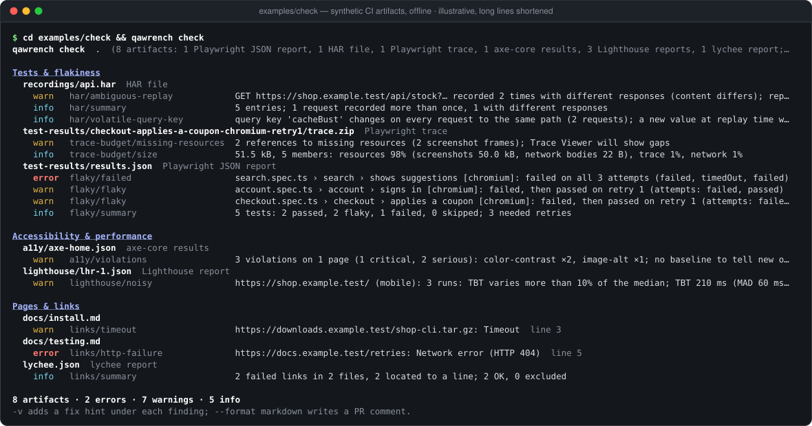

<p align="center">
  <picture>
    <source media="(prefers-color-scheme: dark)" srcset="assets/logo-dark.svg">
    
  </picture>
</p>

<p align="center">
  <strong>Make your E2E and browser CI results trustworthy.</strong><br>
  One offline CLI that reads the artifacts your Playwright job already uploads and tells you which results not to believe.
</p>

<p align="center">
  <a href="https://github.com/tianhaogutum/qawrench/actions/workflows/ci.yml"></a>
  <a href="pyproject.toml"></a>
  <a href="LICENSE"></a>
</p>

<p align="center">
  English · <a href="README.zh-CN.md">简体中文</a>
</p>

<p align="center">
  <strong>Point it at <code>test-results/</code>. Flaky tests, ambiguous HAR replays, broken traces, new a11y violations, noisy Lighthouse runs and dead links in one report. Nothing is re-run.</strong>
</p>

```sh
uvx qawrench check test-results/          # or: pipx install 'qawrench[all]'
```

<p align="center">
  
</p>
<p align="center"><sub>Illustrative: drawn in the output format of <code>qawrench check</code> on the synthetic artifacts in <a href="examples/check/"><code>examples/check</code></a>, long lines shortened. The key lines are pinned by <a href="tests/check/test_cli.py"><code>tests/check/test_cli.py</code></a>.</sub></p>

## Quick start

```sh
uvx qawrench check test-results/                                   # read-only scan of a CI artifacts folder
uvx qawrench check . --format markdown >> "$GITHUB_STEP_SUMMARY"   # job summary / PR comment
uvx qawrench check . --format sarif > qawrench.sarif               # SARIF 2.1.0 for code scanning
uvx qawrench check . --fail-on warning                             # exit 1 on warnings too
```

No account, no browser, no server, no config. `check` recognises artifacts by their content (a Playwright JSON or CTRF report, a `trace.zip`, a HAR, axe or Pa11y JSON, Lighthouse reports, lychee JSON, a pytest statewatch report), so you can point it at a whole workspace.

> **Not on PyPI yet.** Until the first release, install from Git:
> `pipx install git+https://github.com/tianhaogutum/qawrench` or
> `uvx --from git+https://github.com/tianhaogutum/qawrench qawrench check test-results/`
> (Python 3.11+, Linux and macOS).

Try it on the demo artifacts from a clone:

```sh
git clone https://github.com/tianhaogutum/qawrench && cd qawrench/examples/check
uvx --from ../.. qawrench check
```

## Before and after

| Your CI said | What was really going on | `qawrench check` says |
| --- | --- | --- |
| Green | `applies a coupon` failed once and passed on retry | `warn flaky/flaky ... failed, then passed on retry 1` |
| Red, "probably flaky" | `shows suggestions` failed on every attempt | `error flaky/failed ... failed on all 3 attempts` |
| Mocked API tests pass | The HAR recorded `GET /api/stock` twice with different bodies; replay serves one | `warn har/ambiguous-replay` with the entry index |
| Trace uploaded | Two screencast frames are missing; Trace Viewer shows gaps | `warn trace-budget/missing-resources` |
| "LCP got worse" | Three runs, and TBT alone spreads more than 10% of its median | `warn lighthouse/noisy` with median, MAD and range |
| lychee: 1 error | It is in `docs/testing.md`, line 5 | `error links/http-failure ... line 5` |

## What `check` runs

Each check calls the read-only Python API of one qawrench command; nothing is reimplemented, nothing is written. `qawrench check --list-checks` prints the list. Details, rule ids and the JSON schema: [docs/check.md](docs/check.md).

| Area | Check | Finds |
| --- | --- | --- |
| Tests & flakiness | `flaky` | Tests that failed then passed on retry, failed on every attempt, passed unexpectedly or were interrupted (Playwright JSON, CTRF) |
| | `har` | Requests recorded several times with different responses; query keys that change on every request |
| | `trace-budget` | Trace size by category, `--trace-budget` overruns, references to missing screenshots or network bodies |
| | `statewatch` | pytest tests that left watched environment, cwd or module state changed; failures reproduced only after an earlier test (pytest statewatch `report.json`) |
| Accessibility & performance | `a11y` | New axe / Pa11y violations against a baseline found next to the reports, otherwise a summary by impact |
| | `lighthouse` | Median and spread of FCP, LCP, TBT, CLS and Speed Index over repeated runs; failed runs |
| Pages & links | `links` | Failed links from lychee JSON, on the file and (for Markdown) the line that contains them |
| Crawling | `crawlee-export` | Parquet exports that no longer match their manifest |

Checks that need input `check` cannot guess (`page-diff`, `structured-data`, `frontier`) are listed and skipped; `msw-contract` and `mermaid-paths` are not checks (one runs your MSW handlers, the other works on authored diagrams); `--only page-diff` prints the command to run instead. Exit 0 when clean, 1 when a finding reaches `--fail-on` (default `error`), 2 on usage errors. A check that crashes becomes one `internal` finding; the others still run. A missing optional dependency becomes an info finding with the install command.

### In CI

```yaml
- name: Run Playwright
  run: npx playwright test --reporter=json,html
  env:
    PLAYWRIGHT_JSON_OUTPUT_NAME: test-results/results.json
- name: Check test artifacts
  if: always()
  run: |
    uvx qawrench check test-results/ --format markdown >> "$GITHUB_STEP_SUMMARY"
    uvx qawrench check test-results/ --fail-on error
```

The first `check` writes a Markdown report to the job summary (it is also fine as a PR comment body); the second fails the step on errors. Add `--format sarif` and `github/codeql-action/upload-sarif` to see broken links as code-scanning alerts on the line.

## Then fix it: the commands behind the checks

`check` tells you what is wrong. These commands, all in the same install, do the work. Every one is offline. Each has a page in [docs/](docs/README.md).

| Group | Command | What it does | Extra |
| --- | --- | --- | --- |
| Tests & flakiness | `flaky` | Keep a local SQLite retry history of Playwright JSON and CTRF reports; find tests that keep flaking | |
| | `har` | Select HAR fixtures, preflight request matches, plan collision-free replay rewrites | |
| | `trace-budget` | Inventory trace ZIPs against size budgets, compare them, repack losslessly | |
| | `statewatch` | Opt-in pytest plugin: watch selected env/cwd/module state across tests, name the first test that changed it, replay failing pairs; plus a report reader | `[statewatch]` |
| | `msw-contract` | Run your real MSW handlers (in Node) on explicit requests and check status, Content-Type and body against OpenAPI | `[openapi]` |
| Accessibility & performance | `a11y` | Baseline axe and Pa11y results so CI fails only on new findings (SARIF) | |
| | `lighthouse` | Gate Lighthouse numeric audits on repeated runs with an explicit noise policy | |
| | `mermaid-paths` | Turn a Mermaid flowchart into an author-reviewed, keyboard-followable HTML appendix | |
| Pages & links | `page-diff` | Compare two saved HTML snapshots with explicit, auditable noise rules | `[html]` |
| | `structured-data` | Compare JSON-LD and OpenGraph between two saved HTML captures | `[structured]` |
| | `links` | Convert lychee JSON to SARIF with source-verified locations and baselines | |
| Crawling | `frontier` | Audit crawl request deduplication under an explicit URL policy and offline robots rules | `[frontier]` |
| | `crawlee-export` | Export a local Crawlee dataset to typed, verified Parquet | `[parquet]` |

```sh
qawrench flaky import --format playwright --run-id "$GITHUB_RUN_ID" --db ledger.sqlite test-results/results.json
qawrench a11y baseline --format axe a11y/axe-home.json --out a11y-baseline.json
qawrench lighthouse baseline/ current/ --config gate.json
```

The core install has no third-party dependencies. Extras pull in the heavy ones: `pipx install 'qawrench[parquet]'` (pyarrow), `[structured]` (extruct, lxml), `[html]` (beautifulsoup4), `[frontier]` (w3lib), `[openapi]` (PyYAML, jsonschema), `[statewatch]` (pytest plugin: DeepDiff, pytest-replay, filelock), or `[all]`. `msw-contract` also needs Node.js 24+ and your project's own `msw`. `qawrench <command> --help` lists every option.

## Trust and limits

- **Offline, no telemetry.** qawrench opens no network connections. It never fetches the URLs in your reports, HARs or link checks.
- **Read-only by default.** `check` and the analysis subcommands never modify inputs. Commands that write need an explicit output path, and most have `--dry-run`.
- **Nothing is executed** by `check` and the artifact commands: no browser, no test run, no script from a trace or HAR. Two commands run code only because that is their job and only when you call them: `msw-contract` runs your MSW handlers in a bounded Node process, and the `statewatch` pytest plugin runs inside your own pytest session (and replays tests with `--statewatch-confirm`).
- **No secrets in reports.** HAR findings print URLs without their query string; request bodies, cookies and headers are never quoted.
- **Strict inputs.** Each tool reads a documented dialect (for example the Playwright 1.56.1 JSON reporter, Lighthouse 12.8.2, lychee 0.18) and refuses what it cannot account for completely, with an info finding that says why. It does not guess.
- **Artifacts, not your suite.** "Flaky" means "failed, then passed in this run"; use `qawrench flaky` to keep a history across runs. The 10% Lighthouse spread threshold is a fixed heuristic, not a statistical test.

qawrench is independent and not affiliated with Microsoft Playwright, Google Lighthouse, Deque axe, Pa11y, lychee, Apify Crawlee, pytest, MSW or Mermaid.

---

<p align="center">If qawrench told you which green build not to trust, a star helps other people find it.</p>
