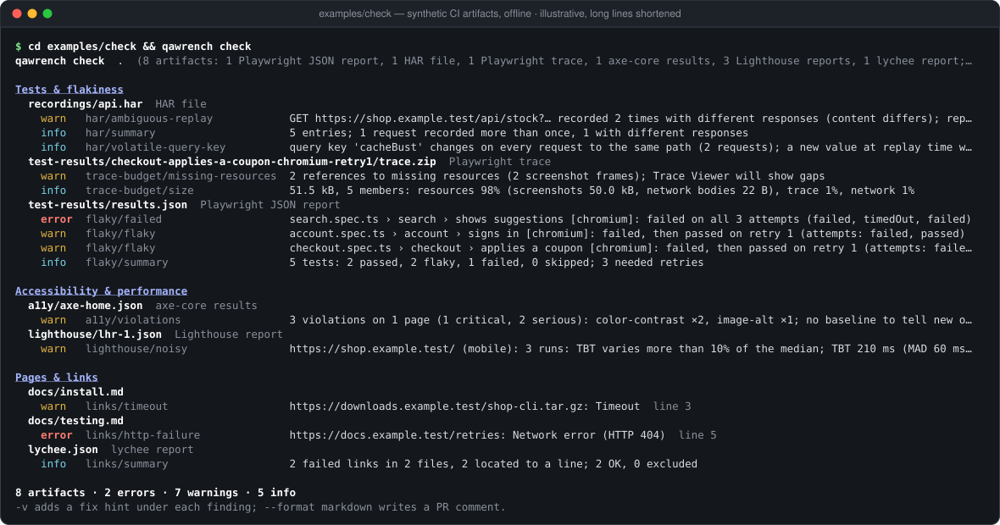

<p align="center">
  <picture>
    <source media="(prefers-color-scheme: dark)" srcset="assets/logo-dark.svg">
    
  </picture>
</p>

<p align="center">
  <strong>让端到端测试和浏览器 CI 的结果值得信任。</strong><br>
  一个离线 CLI：读取 Playwright 任务本来就会上传的产物，告诉你哪些结果不能信。
</p>

<p align="center">
  <a href="https://github.com/tianhaogutum/qawrench/actions/workflows/ci.yml"></a>
  <a href="pyproject.toml"></a>
  <a href="LICENSE"></a>
</p>

<p align="center">
  <a href="README.md">English</a> · 简体中文
</p>

<p align="center">
  <strong>指向 <code>test-results/</code> 即可：不稳定的测试、有歧义的 HAR 回放、残缺的 trace、新增的无障碍问题、噪声过大的 Lighthouse 数据和失效链接，一份报告看全，什么都不重跑。</strong>
</p>

```sh
uvx qawrench check test-results/          # 或：pipx install 'qawrench[all]'
```

<p align="center">
  
</p>
<p align="center"><sub>示意图：按 <code>qawrench check</code> 的输出格式绘制，输入是 <a href="examples/check/"><code>examples/check</code></a> 里的合成产物，过长的行有截断。关键行由 <a href="tests/check/test_cli.py"><code>tests/check/test_cli.py</code></a> 固定。</sub></p>

## 快速开始

```sh
uvx qawrench check test-results/                                   # 只读扫描 CI 产物目录
uvx qawrench check . --format markdown >> "$GITHUB_STEP_SUMMARY"   # 任务摘要 / PR 评论
uvx qawrench check . --format sarif > qawrench.sarif               # SARIF 2.1.0，用于代码扫描
uvx qawrench check . --fail-on warning                             # 有警告也以 1 退出
```

不需要账号、浏览器、服务器或配置。`check` 按内容识别产物（Playwright JSON 或 CTRF 报告、`trace.zip`、HAR、axe 或 Pa11y JSON、Lighthouse 报告、lychee JSON），所以可以直接指向整个工作目录。

> **尚未发布到 PyPI。** 首个版本发布前，请从 Git 安装：
> `pipx install git+https://github.com/tianhaogutum/qawrench` 或
> `uvx --from git+https://github.com/tianhaogutum/qawrench qawrench check test-results/`
> （Python 3.11+，Linux 和 macOS）。

克隆后用演示产物试一试：

```sh
git clone https://github.com/tianhaogutum/qawrench && cd qawrench/examples/check
uvx --from ../.. qawrench check
```

## 前后对比

| CI 显示 | 实际情况 | `qawrench check` 的报告 |
| --- | --- | --- |
| 绿色 | `applies a coupon` 失败一次，重试后通过 | `warn flaky/flaky ... failed, then passed on retry 1` |
| 红色，“大概是偶发” | `shows suggestions` 每次尝试都失败 | `error flaky/failed ... failed on all 3 attempts` |
| 用 HAR 模拟接口的测试通过 | HAR 把 `GET /api/stock` 录了两次且响应不同，回放只会给其中一个 | `warn har/ambiguous-replay`，附条目序号 |
| trace 已上传 | 缺两张截屏帧，Trace Viewer 里会有空白 | `warn trace-budget/missing-resources` |
| “LCP 变差了” | 只有三次运行，TBT 的离散度就超过中位数的 10% | `warn lighthouse/noisy`，附中位数、MAD 和范围 |
| lychee：1 个错误 | 在 `docs/testing.md` 第 5 行 | `error links/http-failure ... line 5` |

## `check` 会运行什么

每项检查调用一个 qawrench 子命令的只读 Python API；不重新实现逻辑，不写任何文件。`qawrench check --list-checks` 列出全部检查。细节、规则 ID 和 JSON 格式见 [docs/check.md](docs/check.md)。

| 领域 | 检查 | 发现什么 |
| --- | --- | --- |
| 测试与不稳定性 | `flaky` | 重试后才通过、每次都失败、意外通过或被中断的测试（Playwright JSON、CTRF） |
| | `har` | 同一请求被录了多次且响应不同；每次请求都在变的查询参数 |
| | `trace-budget` | trace 按类别的体积、超出 `--trace-budget`、引用了却缺失的截图或网络响应体 |
| 无障碍与性能 | `a11y` | 若报告旁有基线，则报告新增的 axe / Pa11y 问题；否则按影响级别汇总 |
| | `lighthouse` | 多次运行下 FCP、LCP、TBT、CLS 和 Speed Index 的中位数与离散度；失败的运行 |
| 页面与链接 | `links` | lychee JSON 中失效的链接，定位到所在文件以及（Markdown 的）行号 |
| 爬取 | `crawlee-export` | 与清单（manifest）不再一致的 Parquet 导出 |

需要额外输入、`check` 无法猜测的检查（`page-diff`、`structured-data`、`frontier`）会列出但跳过；用 `--only page-diff` 会打印应改用的命令。没有问题时退出码为 0，有发现达到 `--fail-on`（默认 `error`）时为 1，用法错误为 2。某项检查崩溃只会变成一条 `internal` 发现，其他检查照常运行；缺少可选依赖会变成一条附安装命令的 info。

### 在 CI 中使用

```yaml
- name: Run Playwright
  run: npx playwright test --reporter=json,html
  env:
    PLAYWRIGHT_JSON_OUTPUT_NAME: test-results/results.json
- name: Check test artifacts
  if: always()
  run: |
    uvx qawrench check test-results/ --format markdown >> "$GITHUB_STEP_SUMMARY"
    uvx qawrench check test-results/ --fail-on error
```

第一条把 Markdown 报告写进任务摘要（也可以直接作为 PR 评论正文）；第二条在有错误时让这一步失败。加上 `--format sarif` 和 `github/codeql-action/upload-sarif`，失效链接会以代码扫描告警的形式出现在对应行上。

## 然后修复：检查背后的命令

`check` 告诉你哪里有问题，下面这些命令负责解决。它们在同一个安装包里，全部离线。

| 分组 | 命令 | 作用 | 扩展 |
| --- | --- | --- | --- |
| 测试与不稳定性 | `flaky` | 把 Playwright JSON 和 CTRF 报告存进本地 SQLite 重试历史，找出反复不稳定的测试 | |
| | `har` | 挑选 HAR 夹具、预检请求匹配、规划无冲突的回放改写 | |
| | `trace-budget` | 按体积预算盘点 trace ZIP，前后对比，无损重新打包 | |
| 无障碍与性能 | `a11y` | 为 axe 和 Pa11y 结果建立基线，CI 只在新增问题时失败（SARIF） | |
| | `lighthouse` | 基于多次运行和明确的噪声策略，对 Lighthouse 数值审计设门槛 | |
| 页面与链接 | `page-diff` | 用明确、可审计的降噪规则比较两份保存的 HTML 快照 | `[html]` |
| | `structured-data` | 比较两份 HTML 抓取中的 JSON-LD 和 OpenGraph | `[structured]` |
| | `links` | 把 lychee JSON 转成 SARIF，位置经源码核实，支持基线 | |
| 爬取 | `frontier` | 在明确的 URL 策略和离线 robots 规则下审计爬取请求去重 | `[frontier]` |
| | `crawlee-export` | 把本地 Crawlee 数据集导出为带类型、经校验的 Parquet | `[parquet]` |

```sh
qawrench flaky import --format playwright --run-id "$GITHUB_RUN_ID" --db ledger.sqlite test-results/results.json
qawrench a11y baseline --format axe a11y/axe-home.json --out a11y-baseline.json
qawrench lighthouse baseline/ current/ --config gate.json
```

核心安装没有第三方依赖。较重的依赖放在扩展里：`pipx install 'qawrench[parquet]'`（pyarrow）、`[structured]`（extruct、lxml）、`[html]`（beautifulsoup4）、`[frontier]`（w3lib），或 `[all]`。`qawrench <命令> --help` 列出所有选项。

## 可信度与局限

- **离线，无遥测。** qawrench 不发起任何网络连接，从不访问报告、HAR 或链接检查里的 URL。
- **默认只读。** `check` 和各分析子命令从不修改输入。会写文件的命令必须显式给出输出路径，大多数支持 `--dry-run`。
- **不执行任何东西。** 不启动浏览器，不跑测试，不执行 trace 或 HAR 里的脚本。
- **报告里没有机密。** HAR 相关的发现只打印去掉查询串的 URL；从不引用请求体、cookie 或请求头。
- **输入严格。** 每个工具只读取有文档说明的格式（例如 Playwright 1.56.1 的 JSON reporter、Lighthouse 12.8.2、lychee 0.18），无法完整解释的输入会被拒绝，并用一条 info 说明原因，不靠猜。
- **看的是产物，不是测试套件。** 这里的“不稳定”指“本次运行中先失败后通过”；跨运行的历史请用 `qawrench flaky`。Lighthouse 的 10% 离散度阈值是固定的经验规则，不是统计检验。

qawrench 是独立项目，与 Microsoft Playwright、Google Lighthouse、Deque axe、Pa11y、lychee 和 Apify Crawlee 均无关联。

---

<p align="center">如果 qawrench 让你知道了哪次绿色构建不能信，点个 star 能帮更多人发现它。</p>
