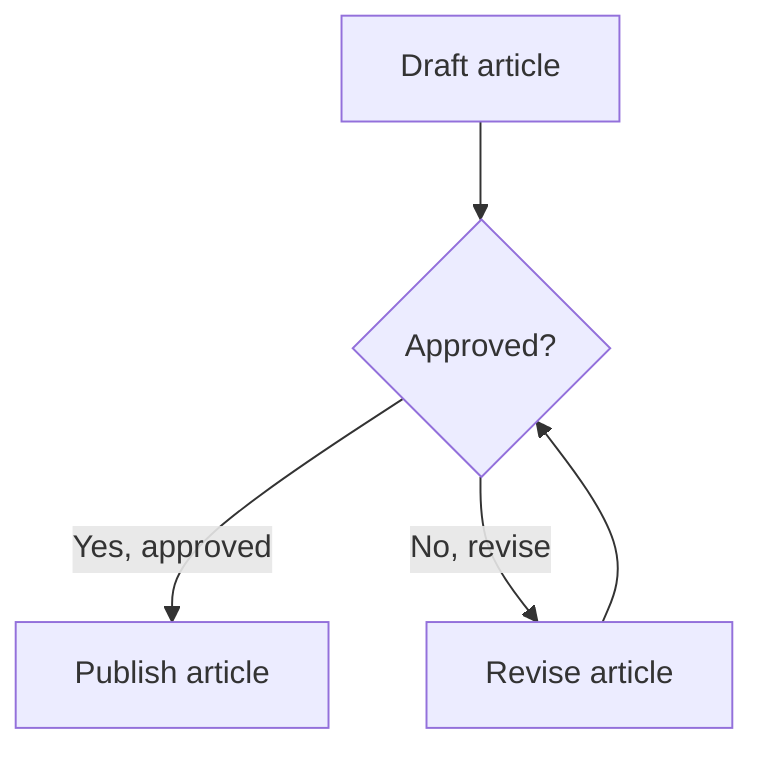

# Publishing an article

The review loop below is accompanied by an author-reviewed path appendix.

This document is an original example. Its code fence contains the exact diagram
from `review-process.mmd`, so the same review applies to its extracted source.
